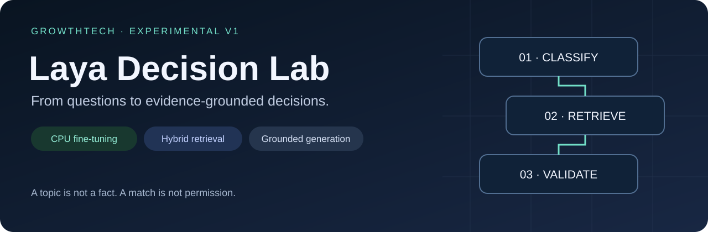
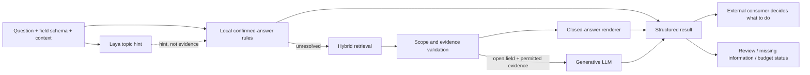
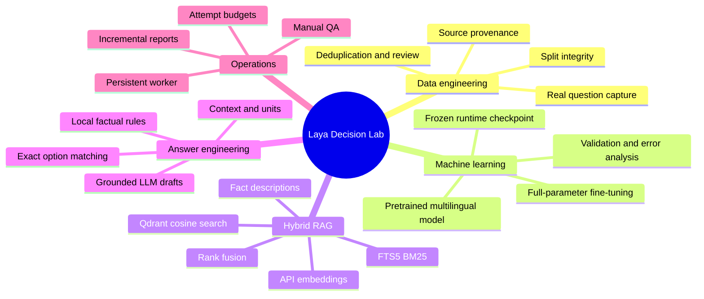
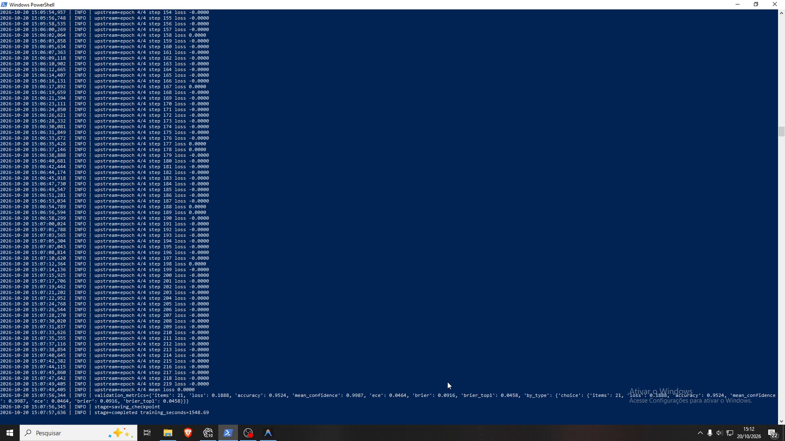

<div align="center">



# Laya Decision Lab

**From multilingual questions to evidence-grounded decisions.**


[Architecture](docs/ARCHITECTURE.md) · [Training & evaluation](docs/TRAINING.md) · [RAG explained](docs/RETRIEVAL.md) · [Reproduction](docs/REPRODUCIBILITY.md) · [Português](README.pt-BR.md)

</div>

## The problem

A form can ask the same thing in many ways and languages. A classifier can identify
the topic and still fail to produce a usable answer. Retrieval can find a similar
record that does not actually support the requested claim. A fluent LLM can write
an answer that has no supporting evidence at all.

This project investigates those boundaries through a real, evolving engineering
case study: classify the question, retrieve scoped knowledge, validate whether it
applies, then render a structured answer or generate a constrained draft.

**This is an independent decision/answer engine, not a standalone LinkedIn bot.**
The separately maintained LinkedIn application system is its first operational
consumer. Browser controls, credentials, submission gates and application ledgers
belong to that consumer and are not included here.

## What was built

| Layer | Implemented approach | What it does not prove |
|---|---|---|
| Question classification | Fine-tuned multilingual Laya, CPU inference | A topic is not a personal fact or permission |
| Knowledge | Confirmed records with sources, constraints and export flags | Missing information is not automatically false |
| Retrieval | Qdrant cosine + SQLite FTS5 BM25 + reciprocal-rank fusion | A nearest neighbor is not sufficient evidence |
| Closed answers | Local rules and exact form-option validation | Rules do not cover every possible paraphrase |
| Open answers | Gemini 2.5 Flash Lite through OpenRouter | Generated text still needs grounding checks |
| Execution boundary | CLI pipeline and persistent JSON-lines adapter | The Lab does not click or submit applications |
| Observability | Checkpoints, statuses, HTTP-attempt accounting, reported costs | Reported spend is not a guaranteed billing cap |

## System overview



This is a conceptual view. Some local answers bypass retrieval and generation;
the external integration may resolve known fields before invoking the Lab at all.

## Evidence, not inflated claims

The pinned question-only experiment used **137 reviewed real examples**, split
into **113 training / 12 validation / 12 diagnostic test** examples, covering
23 topic labels. Full fine-tuning updated **321,908,995 trainable parameters**
with **452 optimizer updates** over four epochs, on CPU with six threads.

| Measure | Recorded result |
|---|---|
| Base → fine-tuned diagnostic test | 8/12 → 10/12 |
| Final validation | 9/12 |
| Training worker time | 925.344 seconds, approximately 15.4 minutes |
| Calibration | Not calibrated |

**These are small, inspected development splits, not an unbiased production
benchmark.** Earlier experiments used different labels and splits. Their scores
must not be presented as directly comparable. See [the full experiment history](docs/TRAINING.md).

## Explore the engineering


The illustration uses conceptual vectors, not actual private data or a projected
embedding-space visualization. The implementation uses **1,536-dimensional vectors**.



## Demonstrations

Two original screen recordings of the development/training sessions have been
preserved locally. They are **not yet published or fully reviewed for privacy**.
The [media plan](docs/MEDIA.md) defines clips, captions and release checks.
There are no fabricated terminal screenshots or placeholder video links here.



**Actual recording, earlier experiment:** this frame shows the 219-example
synthetic-expansion run finishing four epochs (876 updates). It is **not** the
selected 113-example question-only run reported above. The visible validation
score uses a different evaluation set and must not be compared to the selected
checkpoint's 9/12 result. [Frame provenance and review status](docs/MEDIA.md#reviewed-still-and-experiment-matching).

**Illustrative walkthrough, not a measured benchmark:** a monthly salary question
maps to a salary fact; the scope validator checks currency and period; a closed
field receives the locally rendered amount. A question asking for an unsupported
university degree remains unresolved rather than inheriting a similar course fact.

## Run status and reproduction

### Try the public offline demo (Python 3.12, no dependencies)

The current five-test suite also runs the legacy answer/retrieval/adapter checks
against an invented regression profile, with private reads and network blocked.
Operational profile values and answer algorithms are not changed by these tests.

From the project root:

```powershell
python -m venv .venv
.\.venv\Scripts\Activate.ps1
python -X utf8 scripts/run_pipeline.py --public-demo
python -X utf8 -m unittest discover -s tests -v
```

On Linux/macOS, activate with `source .venv/bin/activate`. Do not recreate an
existing development environment just to run this demo; activate it instead.

The public fixture is **invented**, not the author's profile. Nine cases verify
supported answers and deliberate abstentions, using the existing answer renderer.
This entry point does **not** run Laya, embeddings, hybrid RAG or a generative API.
Its console and JSON report make that boundary explicit. It demonstrates the
answer contract, not end-to-end model performance. Four standard-library tests
verify the contract and reject paid/private-mode combinations.

The demo and tests passed in a separate, dependency-free Windows Python environment
containing only the required source, fixtures and tests. A Windows/Linux GitHub
Actions workflow is provided. See the repository's Actions tab for hosted results.

### Full local pipeline

The existing local environment can run these offline diagnostics:

```powershell
.\.venv\Scripts\Activate.ps1
python -X utf8 scripts/run_pipeline.py --self-test
python -X utf8 scripts/retrieve_hybrid.py --self-test
python -X utf8 scripts/linkedin_adapter.py --self-test
```

All three passed during the 2026-10-25 publication audit with **zero API calls**.
These checks require the existing environment; some depend on local knowledge
files. They are **not a clean-clone installation recipe**.

> The offline public demo is reproducible. Full-pipeline publication preparation
> is still in progress. Private datasets, trained checkpoints,
> cached model files and candidate profiles are intentionally excluded. A new clone
> cannot yet reproduce the full private workflow without supplying those artifacts.

See [reproducibility and exact prerequisites](docs/REPRODUCIBILITY.md) before running
training or API commands. No new training is required to explore the architecture.

## What still needs work

- Broader paraphrase coverage and consistent fact handling across the consumer boundary.
- Fresh, untouched evaluation data and better coverage of sparse classes.
- A public full-pipeline fixture and artifact path beyond the existing offline rules demo.
- Configurable model/artifact locations for clean full-pipeline installations.
- Privacy-reviewed video excerpts (one authentic still is already included).
- Separate reporting for retrieval quality, answer correctness and operational success.

These are documented engineering limitations, not hidden behind a single accuracy
score. The external browser application's pagination and search-selection gaps are
tracked separately; they are not classifier capabilities.

## Project ownership and acknowledgments

Developed by **Everton Soares / GrowthTech**, with AI-assisted implementation.
Human contributions include problem definition, requirements, project direction,
manual QA, error reproduction, log inspection, selector investigation, manual
corrections and validation of personal facts. This is a personal engineering project,
not a claim of enterprise customer deployment.

The upstream Laya model/library was **not invented here**. This repository develops
a domain-specific experiment and integration around it. See
[third-party notices](THIRD_PARTY_NOTICES.md), [contribution policy](CONTRIBUTING.md)
and [security boundaries](SECURITY.md).
