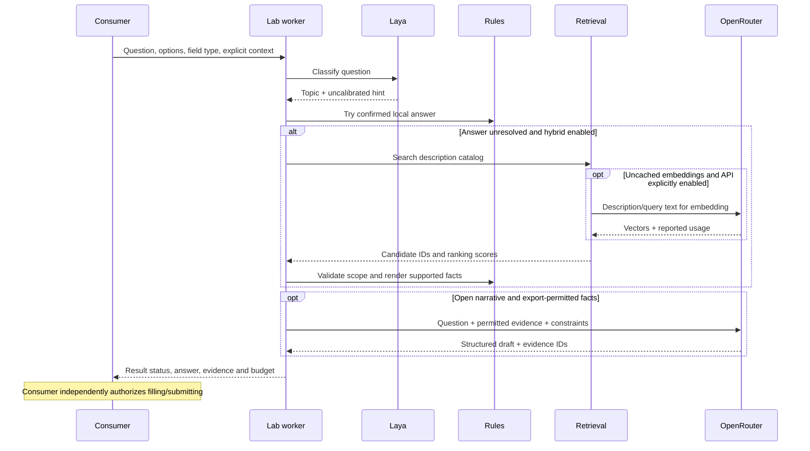

# Architecture and responsibility boundaries

## 1. Four different kinds of knowledge

The system deliberately separates model parameters, topic definitions, factual
records and application policy. A training label such as “language proficiency”
is not the applicant's English level. A retrieval match is not confirmation that
the value applies to the current question. A default chosen by the user is not
evidence of professional experience.

| Component | Owns | Does not own |
|---|---|---|
| Laya checkpoint | Learned question-to-topic behavior | Candidate biography, eligibility, submission |
| Local profile | Facts, preferences, provenance and constraints | Browser behavior |
| Retrieval index | Searchable descriptions and record identifiers | Authority to answer or submit |
| Renderer / generator | Answer construction and evidence checks | Legal consent or browser navigation |
| External consumer | Form lifecycle and operational authorization | Training/evaluation results |

## 2. Runtime sequence

This sequence describes responsibilities, not a promise that every request uses
every component. Known fields may be resolved entirely by the consumer before
it calls the worker. The Lab may also stop at a missing-information result.

## 3. Module map

| Existing file | Responsibility |
|---|---|
| `scripts/prepare_dataset.py` | Capture import, deduplication, labels, split preparation and review exports |
| `scripts/run_probe.py` | CPU training setup and process supervisor |
| `scripts/train_probe.py` | Head-only/full fine-tuning and recorded model comparisons |
| `scripts/evaluate_checkpoint.py` | Reloaded-checkpoint evaluation and diagnostic ablations |
| `scripts/validate_knowledge.py` | Knowledge-file validation |
| `scripts/retrieve_knowledge.py` | Deterministic baseline and applicability checks |
| `scripts/retrieve_openrouter.py` | API catalog routing, transport and evidence boundary |
| `scripts/retrieve_hybrid.py` | Embedding cache, vector/lexical retrieval and rank fusion |
| `scripts/generate_answer.py` | Closed rendering and constrained open-text generation |
| `scripts/run_pipeline.py` | Batch orchestration, frozen classifier and shared budget |
| `scripts/linkedin_adapter.py` | Preview requests and persistent JSON-lines service |

## 4. Integration is a boundary, not a merger

The Lab uses its own virtual environment so the automation does not need the ML
stack installed in its interpreter. The consumer starts a persistent worker;
stdout is reserved for protocol messages and stderr carries diagnostic logging.
The model is loaded once rather than once per field.

The Lab's output retains `ready_to_submit=false`. In the LinkedIn consumer,
explicitly enabled integration can promote supported answers and eligible drafts
to fillable values. The consumer still owns submission authorization, ledger
reservation, duplicate prevention and confirmation. Protected fields such as
contact details, education and legal authorization retain specialized handling.

The latest language-option fixes in the consumer are **not automatically changes
to the Lab's standalone renderer**. This is an important current limitation:
documentation and tests must identify which side of the boundary they describe.

## 5. Status is part of the interface

| Status | Meaning |
|---|---|
| `answer_ready` | Supported answer prepared; not submission permission |
| `draft_needs_review` | Generated draft; review flags and evidence matter |
| `needs_information` | No supported answer produced; not proof the user lacks the skill |
| `pending_budget` | Processing stopped at the configured request/spend boundary |
| `error` | Transport/runtime failure; not a factual negative answer |

An unresolved question may indicate missing facts, a wording gap, unmatched
options, context ambiguity or failed routing. Logs should preserve those causes
instead of equating every failure with a low-confidence model.

## 6. Why a classifier alone was insufficient

The first practical failures exposed an end-to-end issue: recognizing “English”
does not map `C1` to `C1 – Advanced`, or answer a boolean B2-conversation question.
Those tasks require factual and schema-aware resolution. Similarly, a consent
question can be classified correctly without having authorization to accept it.

The resulting design uses ML where it can help with variation, deterministic
logic where units and contracts must be explicit, and generation where prose
adds value. Its quality must be evaluated at each boundary.
