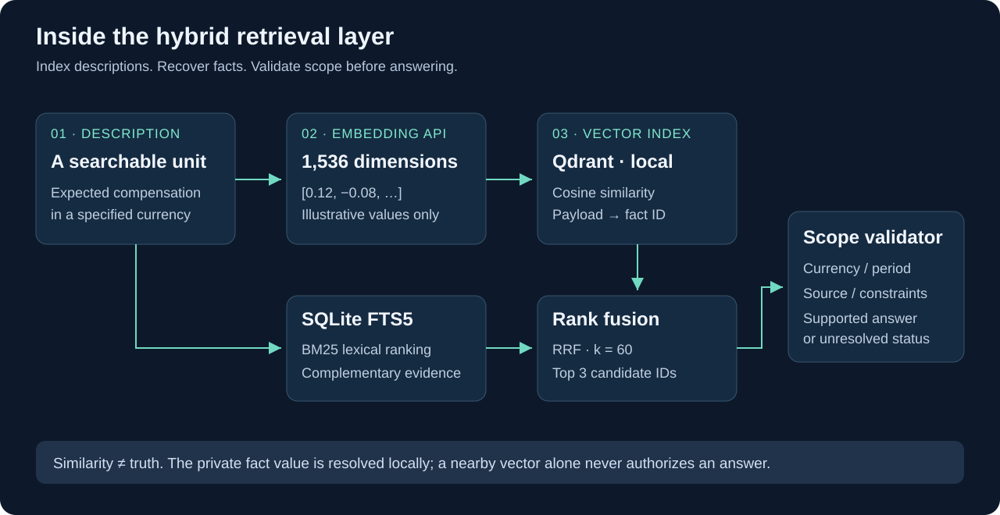
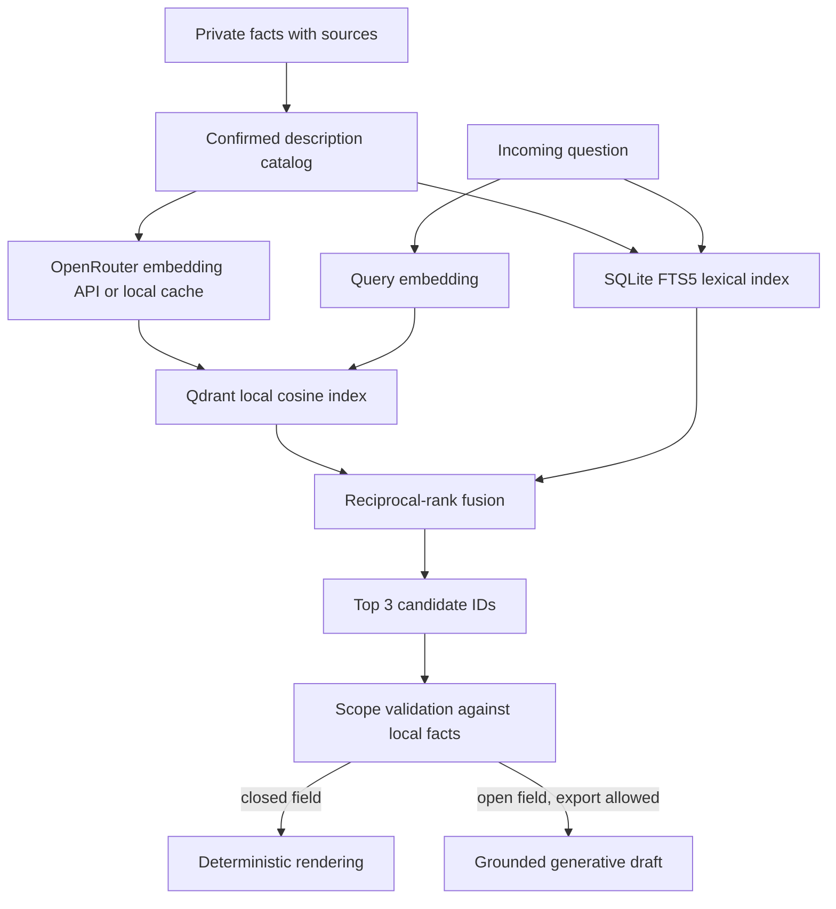

# RAG, embeddings and the vector database

## What is indexed?

This is a **structured-fact retrieval system**, not a giant PDF chatbot. A local
profile stores records with identifiers, values, sources, constraints and status.
An abstract description of each eligible record becomes a searchable unit.

Early retrieval experiments indexed eight units. The local catalog later expanded
to **34 confirmed descriptions from 35 profile records**, with one clarification
record withheld. Those counts describe a private development snapshot, not a
public dataset included in this repository.

A chunk is the textual unit being indexed. An embedding is its numerical
representation. A category is a classifier label. These can refer to related
concepts but they are not interchangeable objects.

| Object | Illustrative example |
|---|---|
| Topic label | Salary expectation |
| Description/chunk | Expected gross monthly compensation in a specified currency |
| Private fact value | A confirmed amount, currency and period |
| Vector | 1,536 floating-point coordinates derived from the description |
| Payload | Record identifier used to retrieve the local fact |

Examples in this document are conceptual, not exports of personal values.

## Index and query flow





### Dense search

`openai/text-embedding-3-small` is called through OpenRouter with 1,536 dimensions.
Qdrant runs in local persistent mode, not as a hosted Qdrant service. Cosine
similarity ranks description vectors against the query vector. A model change
requires consistent re-embedding; vectors from different embedding models are
not treated as interchangeable.

### Lexical search

SQLite FTS5 uses BM25 to rank textual matches. The current search builds an
in-memory lexical index from the catalog, with Unicode tokenization and accent
normalization. It is BM25, not a separate scikit-learn TF-IDF vectorizer.
Lexical matching complements dense search for explicit terms, currencies and
technology names, but does not guarantee exact intent matching.

### Rank fusion

The implementation uses equal-weight reciprocal-rank fusion with `k=60`:

```text
score(record) = sum(1 / (60 + rank_in_each_retriever))
```

Ranks start at one. A record present in both result lists receives contributions
from both. The top three combined candidates are returned. RRF values are ranking
scores, not confidence probabilities or permission to answer.

### Cache and storage

Embedding cache keys hash model identifier, vector dimensions and text.
Cached vectors avoid repeated API charges for identical input. A catalog
signature identifies the collection; the current implementation upserts catalog
points during searches. Incremental-index optimization remains future work.
Qdrant payloads identify facts; full personal values remain in the profile.

## Why search can succeed while answering fails

“Current salary” and “expected salary” may retrieve the same neighborhood but
require different facts. Residence does not prove work authorization. A course
completion is not a bachelor's degree. Local applicability checks are necessary
even when a candidate has a high similarity score.

There is no calibrated out-of-catalog acceptance threshold. Unsupported queries
can still retrieve neighbors. The initial authored diagnostic had 5/6 supported
queries at rank one and 6/6 within the top three; two unsupported queries also
returned neighbors. This is development evidence, not a production recall claim.

## What leaves the machine?

- Description text and incoming questions may be sent for embeddings or routing.
- Confirmed facts marked for AI export may be sent for narrative generation.
- A local database does not make the entire pipeline private or offline.
- Disabling API calls does not manufacture missing cache entries.

Data minimization and redaction are required before using sensitive questions.
Embeddings are derived data and should not be considered anonymous by default.

## Cost semantics

Laya inference and Qdrant local queries do not create per-request provider fees.
Embedding and generative requests do. The pipeline sums provider-reported
`usage.cost`, and counts HTTP attempts including retries. Unknown cost responses
are tracked separately. A stop threshold applies after reported spend; it is not
a guarantee that a request cannot cross the threshold. Consumer console totals
may be cumulative across fields, not the cost of the displayed question alone.

The embedding choice was a practical API-first starting point, not the winner
of a controlled comparison. Future experiments should compare retrieval quality,
latency, coverage and cost on the same fixed question set.
