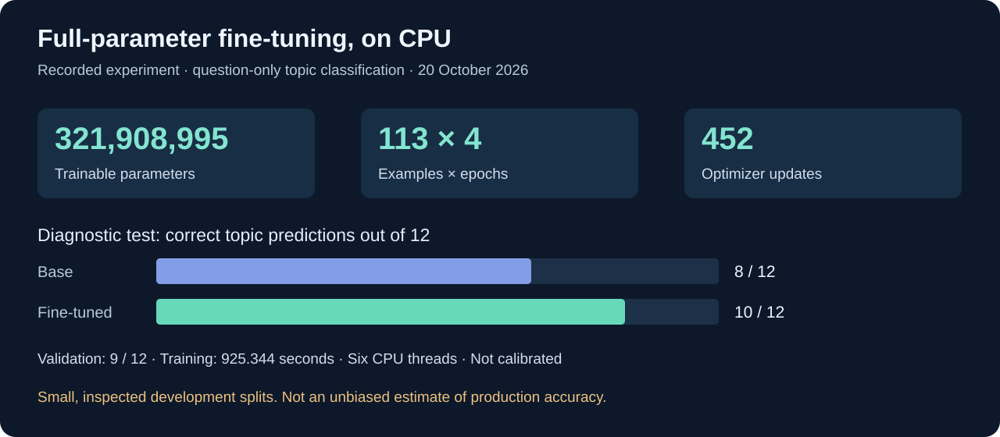
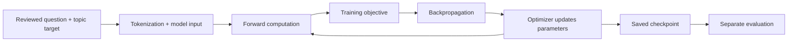
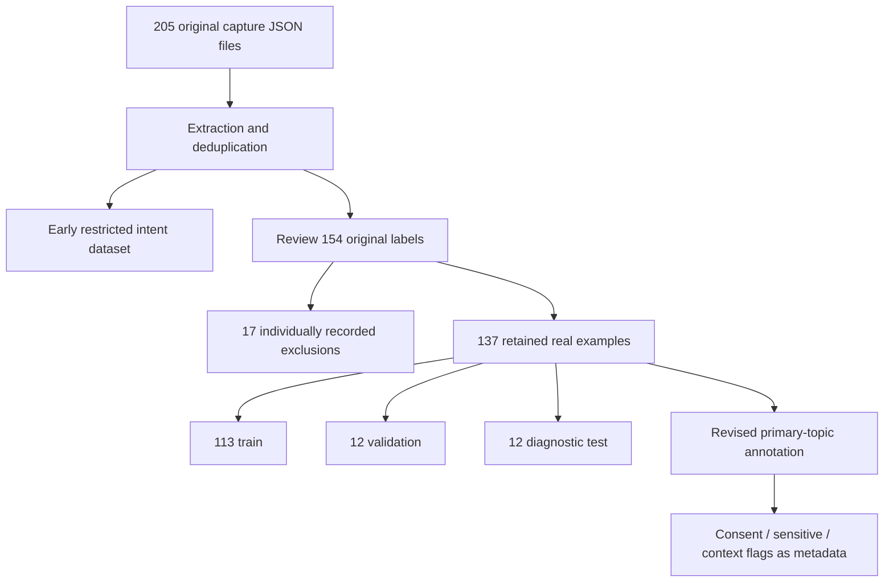

# Fine-tuning and evaluation record

## What was trained

The base model is `convaiinnovations/laya-multilingual`. The selected experiment
pins model revision `1720e3e3357cfe1e281542e223f8273b0890ca34` and uses the upstream
Laya implementation. This project did not pretrain the multilingual encoder.

The task is **primary-topic classification of form questions**. Personal answers
are not the training targets. For example, a salary question is labeled with its
topic; the model is not taught the applicant's requested compensation.

## What changing weights means

An example is an input/target pair. A parameter is a trainable number inside the
model. An epoch is one pass through the training examples. An optimizer update
changes trainable parameters using gradients; it is not a new question added to
the dataset. Increasing epochs repeats the data and may increase overfitting.

The implementation uses upstream Laya's training objective and configuration,
not a claim that this is standard autoregressive chat-model next-token training.
The selected configuration records `loss=soft-ce`, with upstream settings for
sampling and auxiliary terms preserved in the run artifact. A full derivation of
that upstream objective is outside this project's validated claims.

The first probe froze the encoder and trained only heads. Later runs used full
fine-tuning: encoder and heads were trainable. This is **not LoRA or QLoRA**.
The selected run records changes to the head and a non-unchanged encoder.

## Data lineage

Initial capture preparation read 205 capture JSON files. Captures are occurrences,
not automatically unique labeled training examples. Deduplication, eligibility
review and topic annotation produce a smaller dataset.

The arrows summarize preparation history; they do not claim that 205 files map
one-to-one to 154 labels. Real topic revision preserves rows and split membership.
Flags are annotations, **not additional outputs learned by the current model**.

## Experiment history

| Stage | Data and purpose | Recorded observation |
|---|---|---|
| Feasibility | 12 synthetic cases; short head-only/full probes | Verified training mechanics, not domain quality |
| Early real intents | 51 train / 34 evaluation | Base 32/34 → trained 33/34 |
| Synthetic expansion | 51 real + 168 authored training cases | No real-evaluation accuracy gain; authored diagnostic regressed 21/21 → 20/21 |
| Real audit | 113 train; 12 validation; 12 test; 23 topics | Base test 7/12 → 10/12; validation 9/12 |
| Refined topics, selected | Same row/split membership, revised labels | Base test 8/12 → 10/12; validation 9/12 |
| Context experiment | Captured field context added | Test 10/12; no demonstrated gain over question-only control |

Earlier and later scores are not directly comparable because the taxonomy and
evaluation sets changed. The table documents learning and failed hypotheses,
not a monotonically improving benchmark curve.

## Selected checkpoint configuration

Source: local run `full_20261020_185211_497996/result.json`.

A [machine-readable metrics extract](TRAINING_EVIDENCE.json) records the selected
values and the private source artifact's SHA-256. It excludes local paths and
question/answer data. The hash provides traceability, not independent validation.

| Setting | Recorded value |
|---|---|
| Total / trainable parameters | 321,908,995 / 321,908,995 |
| Device / threads | CPU / 6 |
| Epochs / training examples | 4 / 113 |
| Micro-batch / accumulation | 1 / 1 |
| Optimizer updates | 452 |
| Encoder / head learning rate | 0.000025 / 0.0001 |
| Weight decay / gradient clip | 0.01 / 1.0 |
| Input / head token limits | 512 / 320 |
| Seed | 42 |
| Mixed precision / gradient checkpointing | Disabled / disabled |
| Training time | 925.344 seconds |
| Diagnostic test | 8/12 base; 10/12 fine-tuned |
| Validation | 9/12 |
| Calibration status | False |

## Hardware and supervision

The owner's machine has a Ryzen 7 3700X, 32 GB RAM and GTX 1050 Ti with 4 GB VRAM.
The selected training run used **CPU**, not that GPU. The recorded supervisor
peak process-tree RSS was approximately 9.7 GiB. RSS is not GPU memory and is
not a guarantee of identical usage on another machine.

Full dataset runs used a two-hour timeout, sampled 16 GiB process-tree RSS limit
and a 3 GiB free-system-RAM floor. These are best-effort software controls, not
thermal, power or hardware safety guarantees. Six threads leave some desktop
capacity available but do not guarantee absence of scheduling contention.

## Errors that changed the design

- A consent-to-contact question mixes contact information and permission.
- “If you chose Other” requires context absent from the short label.
- “Summary” has little standalone semantic information.
- Disability follow-ups combine topic, sensitivity and dependency.
- Work-hours agreements combine availability with consent.

This motivated primary topics plus independent review flags. It did not justify
declaring the model correct whenever a gold label was inconvenient.

## Overfitting and statistical limits

The analogy to financial in-sample/out-of-sample work is useful: training fits
parameters, validation supports development decisions, and untouched testing
estimates generalization. Here, however, the splits are not established as
independent temporal market windows. Repeated error inspection and label revision
make the current test a **development diagnostic**.

Twelve test items are too few to support strong broad-accuracy claims. Several
sparse topics lack held-out coverage. High softmax confidence is not calibrated
probability. One recorded misclassification was extremely confident.

More epochs on the same inspected questions will not solve missing facts,
unmatched form options or broken selectors. Further training is paused pending
new reviewed data and a preregistered evaluation protocol.

## Next valid experiment

Collect fresh real questions, group related/duplicate forms before splitting,
freeze annotation rules, use validation for selection, then evaluate once on an
untouched set. Report per-topic support, confusion patterns, abstentions and
end-to-end answer correctness separately. Preserve failures and negative results.
